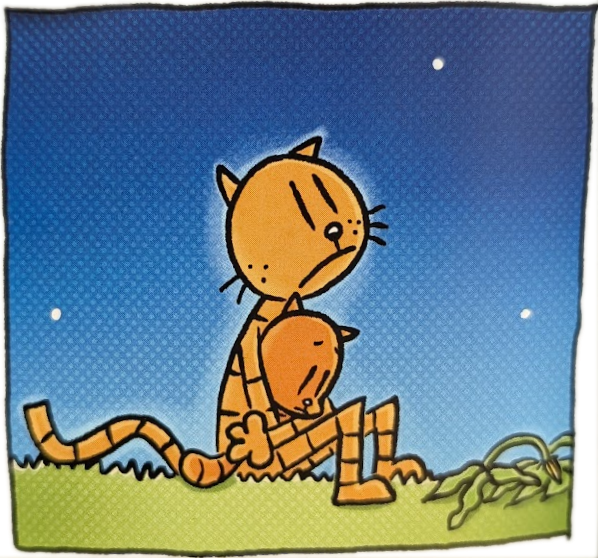
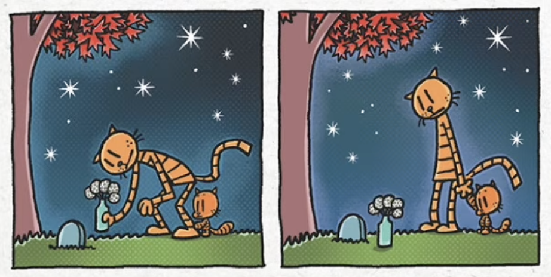
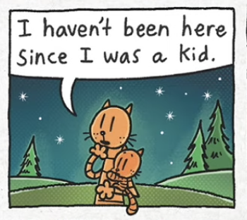
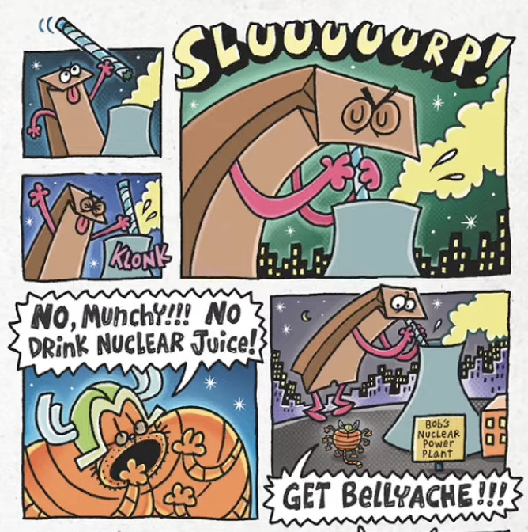
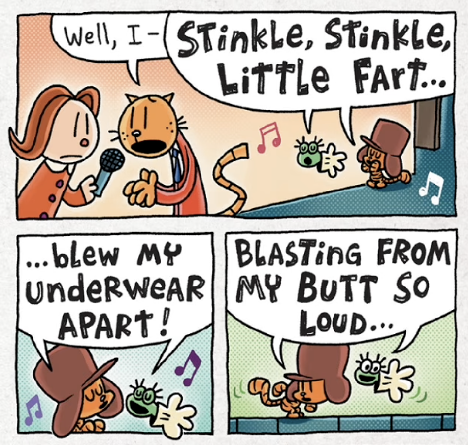
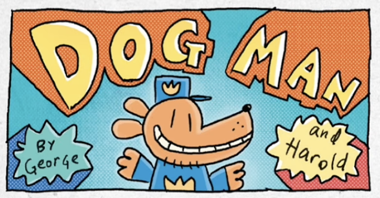
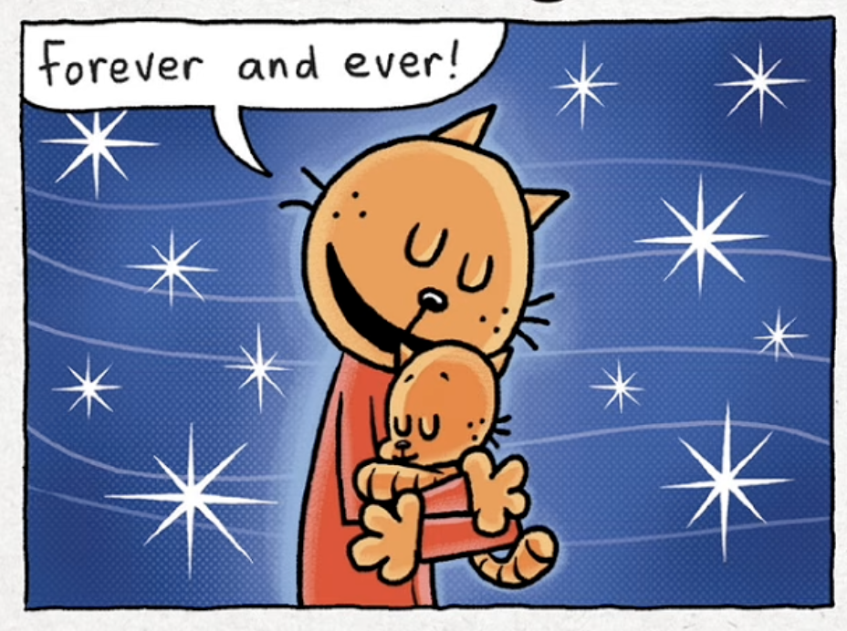

import Subtitle from '../../components/probabilistic/Subtitle.jsx';

# Psst: Dog Man is Actually Good

<Subtitle>Just Don’t Tell The Kids</Subtitle>

If your child were your clone, how would you treat them?  Would you want them to be the same as you?  Or would they instead change you?  Dav Pilkey has regularly topped the bestseller charts over the past decade with his Dog Man series which, underneath its silliness, explores these themes.

I started to enjoy these books because of the joy they brought to my kids.  Having been required to read and re-read them, I think they’re much better than people realise and deserve a place amongst the best of children’s books.

<figure className="dog-man-figure">
  
  <figcaption>Dog Man: For Whom the Ball Rolls, p. 210</figcaption>
</figure>

I’ll pull on a couple of threads to explain why:

First, the characters have believable motivations for their actions, and unusual depth.

In children’s books, we’re more used to good vs. evil, often with little moral ambiguity or psychological complexity.  With Petey, the central character in Dog Man, we have a much richer picture.  He starts as a cardboard evil villain, but begins to change when he clones himself using a mail order kit and - to his surprise -  the clone is a baby who needs looking after.

Lil’ Petey turns out to be good and to love his ‘Papa’ unconditionally, and at this point we might expect a straightforward redemption arc where Lil’ Petey turns his ‘Papa’ good.  But Pilkey continues to defy expectations.

Petey stops his evil deeds, but does not become a caricature ‘goodie’ or become anything like Lil’ Petey.  He remains a pessimist, struggles with depression, and feels unworthy of forgiveness.

Nonetheless, Petey begins to love Lil’ Petey, and this is the driving force behind his redemption.  Depth is added through the character of Grampa, who was cruel to Petey as a child and abandoned him.  Petey is able to forgive him, but not to love him.  Petey is able to break the cycle of cruelty and turn into a good 'father', but he never comes to terms with Grampa’s rejection of him. Grampa, meanwhile, does not change.  Petey can't undo his childhood, but caring for Lil' Petey helps him process his difficult upbringing. The scene in which he visits his mother's grave with Lil' Petey is particularly touching when viewed with this in mind.

<figure className="dog-man-figure dog-man-figure--large">
  

    
    
  

  <figcaption>Dog Man: Grime and Punishment, p. 218 and p. 219</figcaption>
</figure>

Contrast this to another one of my favourite children's series - The Worst Witch.  In these books, the characters are largely fixed: Miss Hardbroom doesn’t really learn from her mistakes in her treatment of Mildred or recognise Mildred’s good qualities, despite repeated evidence of them.  The depth here  concentrates on the mental world of children and how they perceive the adults around them.  Both series take children seriously, just in different ways.

So in Dog Man, we discover our genes do not determine who we become, that people who have done bad things can be rehabilitated, but that we shouldn’t expect fairytale endings.  Not bad for a series in which Munchy, a giant radioactive lunch bag, terrorises a city.

<figure className="dog-man-figure dog-man-figure--large">
  
  <figcaption>Dog Man: Grime and Punishment, p. 147</figcaption>
</figure>

Second, Pilkey masterfully disguises educational content and positive themes behind a silly facade. The books encourage kids to read and find their own way to shine, especially those like his fictional alter egos George and Harold who struggle in a traditional school setting.

Here he pulls off an implausible double bluff: the books are often dismissed by adults as puerile garbage, which supercharges their popularity with kids.  But the books are, in fact, high quality.

This works particularly well because the first book *is* very puerile, and adults will struggle to hide their contempt for it when reading it to their children.  But there’s nothing mean or inappropriate - Pilkey just gets what makes a 7 year old laugh.  It’s only edgy if you’re an adult who forgot that farts are funny.

<figure className="dog-man-figure dog-man-figure--large">
  
  <figcaption>Dog Man: Mothering Heights, p. 111</figcaption>
</figure>

Even from the first book, difficult vocabulary is deliberately included (‘obsequious’, ‘diabolical’, ‘convoluted’) - something that becomes a hallmark of the series.  Do you know what ‘flagitious’ means? My seven year old does!

Not only that, the art style is simple, and at least ostensibly within reach of children:  The trick here is that the Dog Man books are a comic-within-a-comic - they’re written by the characters George and Harold, who are fifth graders.   In addition, step-by-step guides to illustrating the characters are included at the end of each book.

<figure className="dog-man-figure">
  
  <figcaption>Dog Man, p. 10</figcaption>
</figure>

But Pilkey goes further: a spin off series ‘Cat Kid Comic Club’ centres around lessons for writing comics, helping to explain to kids how to generate ideas, and exploring a variety of styles.  How many other kids’ books get children reading what are essentially lessons in how to write, without them really noticing?

So you may not appreciate the humour of an army of supa angry psychokinetic tadpoles, but you should appreciate the quality of Dog Man. Just don’t be too enthusiastic, you’ll give the game away.

<figure className="dog-man-figure">
  
  <figcaption>Dog Man: Mothering Heights, p. 210</figcaption>
</figure>
